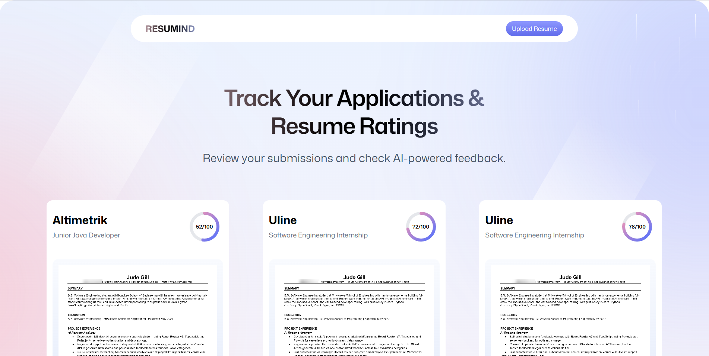

# Resumind

**Resumind** is an AI-powered resume analyzer that gives you instant, actionable feedback on your resume — so you can stop guessing and start getting callbacks.

[**Try it live →**](https://ai-resume-analyzer-three-kohl.vercel.app/) (free Puter sign-in required)



---

## What it does

Upload your resume and Resumind will analyze it across four key dimensions:

- **Tone & Style** — Is your language confident, professional, and consistent?
- **Content** — Are you communicating impact, or just listing duties?
- **Structure** — Is your resume easy to scan in 6 seconds?
- **Skills** — Are the right keywords present for the roles you're targeting?

You'll also get an **ATS score** — a measure of how well your resume would survive an Applicant Tracking System before a human ever sees it.

---

## How it works

1. Sign in with your Puter account (free)
2. Upload your resume as a PDF
3. Get a full breakdown with a score, tips, and explanations — in seconds

Your resumes are stored privately in your Puter account and can be reviewed anytime.

---

## Built with

- [React Router v7](https://reactrouter.com) + TypeScript
- [TailwindCSS v4](https://tailwindcss.com)
- [Puter.js](https://puter.com) for auth, file storage, key-value storage, and AI calls
- [Claude](https://anthropic.com), the model behind the analysis
- PDF.js for converting the uploaded PDF into a preview image
- Docker for containerized builds, deployed on Vercel

---

## Running locally

```bash
git clone https://github.com/gillj-ross/ai-resume-analyzer.git
cd ai-resume-analyzer
npm install
npm run dev        # http://localhost:5173
```

No API keys are needed. Puter handles auth, storage, and AI calls in the browser once you sign in.

Production build:

```bash
npm run build
npm run start
# or with Docker:
docker build -t resumind .
docker run -p 3000:3000 resumind
```

---

## Credits

Based on the [JavaScript Mastery](https://www.youtube.com/@javascriptmastery) AI Resume Analyzer tutorial. I used it as a starting point to learn React Router v7 and Puter.js, then deployed it myself.
